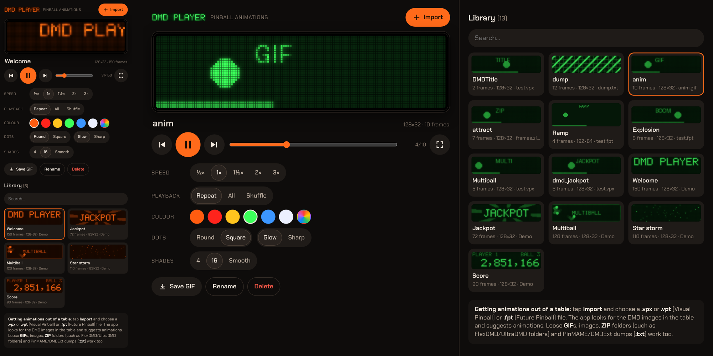

# DMD Player

Plays pinball DMD animations (the orange dot-matrix displays) and extracts them from **Visual Pinball** (`.vpx`, `.vpt`)
and **Future Pinball** (`.fpt`) table files. Works as a web page and as an Android app (phone portrait, tablet
landscape, full screen landscape), fully offline.



## What it does

- **Import** from a table: the app reads the images inside the table and suggests animations:
  - Future Pinball: *image lists* in the table become animations straight away; images (BMP, TGA, JPG, PNG, also LZO-compressed) are read.
  - Visual Pinball: embedded images (PNG/JPG/GIF/WEBP and the LZW-compressed bitmaps).
  - Numbered images of the same size (`dmd_1`, `dmd_2`, …) become one animation.
  - Images with DMD proportions (128×32, 192×64, 256×64 and multiples) are listed separately; other images (playfield, backglass) can be picked and merged by hand.
- Also: animated **GIF**s, single images, **ZIP** files (for example a FlexDMD/UltraDMD folder, or a `.vpz`) and **PinMAME/DMDExt dumps** (`.txt`).
- **Playback** with round or square dots, glow, 4/16 shades or smooth, in orange, red, yellow, green, blue, white or the original colours; speed ½×–3×; repeat, play all, or shuffle.
- **Full screen** in landscape with the screen kept on: handy on a tablet in a cabinet or as a small DMD next to your PC. Swipe for the next animation.
- **Save GIF** of an animation in the chosen style.
- The library is kept in the app (IndexedDB, frames gzip-compressed).

### What it cannot do
Many Visual Pinball recreations of real machines get their DMD from a **PinMAME ROM**; those animations are not in the
table file. In that case make a dump with DMDExt or PinMAME and import the `.txt`.

## Build

```sh
python3 build.py                 # src/ -> index.html (web) and android/assets/index.html (offline)
android/build.sh                 # APK without Gradle (aapt, javac, dx, zipalign, apksigner; android-23 platform)
```
The app font comes from `tools/fonts.py` (Chakra Petch via Fontsource).

## Tests

```sh
python3 tools/make_fixtures.py   # makes small synthetic .vpx/.fpt/.gif/.zip/.txt files in test/fixtures
node tools/nodetest.js <raw_lzw_bmp_128_128_data.bin>   # parsers (file from the vpin test data)
node tools/uitest.js <dir>       # Playwright: import, merge, GIF, full screen
```

## Files

| | |
|---|---|
| `src/formats.js` | OLE/CFB reader (reads large tables piece by piece), VPX BIFF records, LZW, Future Pinball records, LZO1X, GIF, TGA, ZIP, dumps, grouping |
| `src/dmd.js` | dot renderer, resampling to the DMD grid, 5×7 font, demo animations, GIF encoder |
| `src/app.js` | library, player, import screen |
| `android/` | WebView app (`nl.rarevogel.dmdspeler`) |

The file formats were worked out with the help of [vpin](https://github.com/francisdb/vpin) (Visual Pinball) and
[fp-addons-sdk](https://github.com/PinSimDB/fp-addons-sdk) (Future Pinball); no code was copied from them.

License: MIT (code), SIL OFL 1.1 (font).
